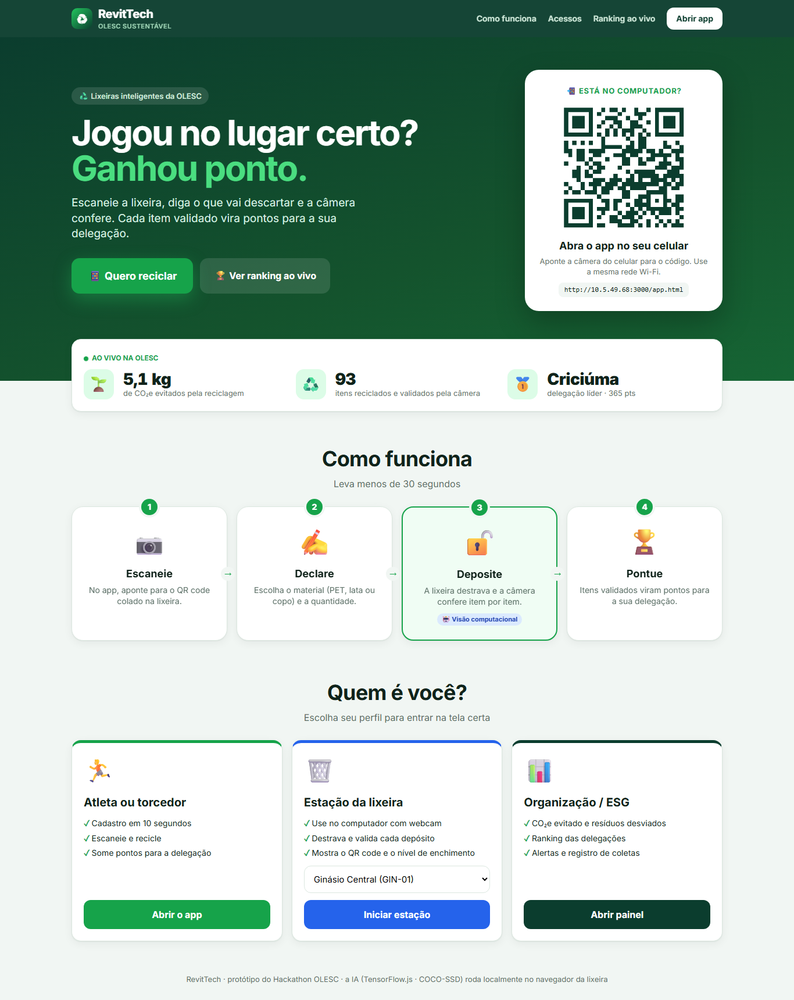
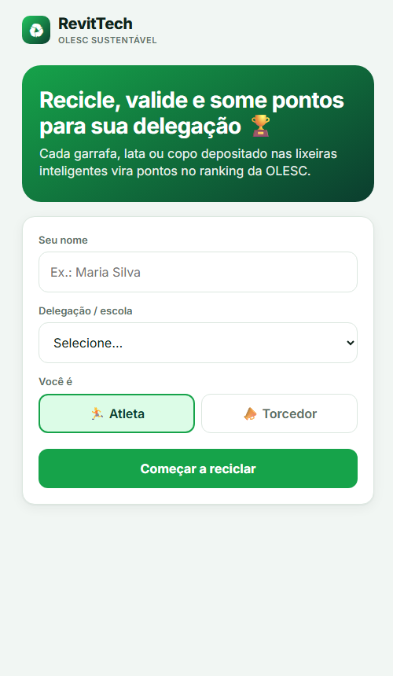
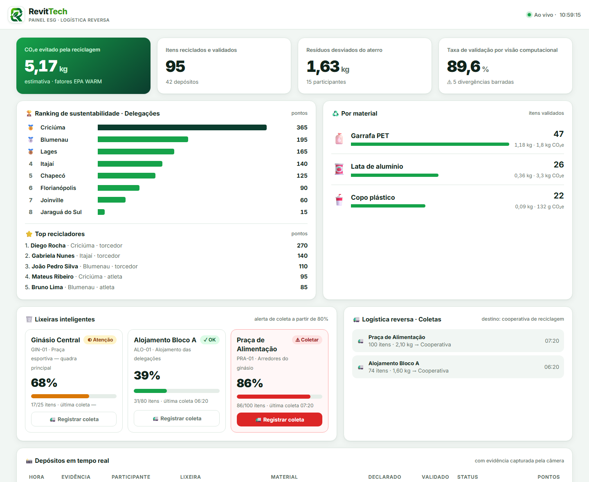
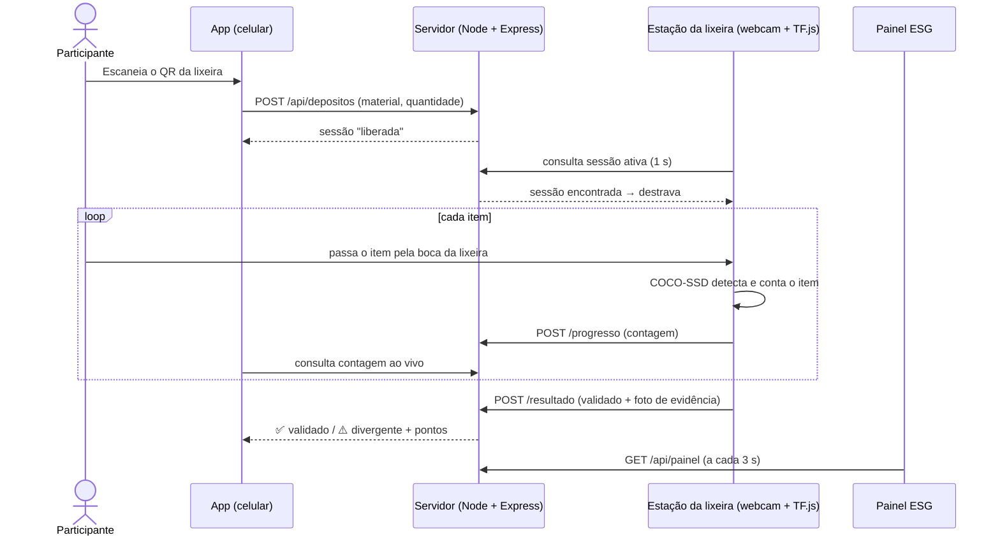

# RevitTech ♻️

**Lixeiras inteligentes com visão computacional para coleta seletiva, logística reversa e medição de impacto ambiental em grandes eventos esportivos.**

Protótipo desenvolvido no Hackathon da **OLESC** para o desafio *"Sustentabilidade e Logística Reversa em Grandes Eventos Esportivos (ESG)"*.

> **Jogou no lugar certo? Ganhou ponto.**
> O atleta ou torcedor escaneia a lixeira no app e declara o que vai descartar. A lixeira destrava e uma câmera com IA confere item por item o que foi depositado. Só os itens validados viram pontos para a delegação.



---

## O problema

Um evento do porte da OLESC gera muitos resíduos sólidos (garrafas plásticas, latas, copos, embalagens) nas praças esportivas, alojamentos, ginásios e arredores. O desafio pede:

- promover a **coleta seletiva**;
- fazer a **gestão dos resíduos** e a **logística reversa**;
- **medir o impacto de carbono**;
- **engajar atletas e torcedores** na sustentabilidade do evento.

Campanhas de reciclagem com recompensa costumam ter um ponto fraco: **ninguém confere se o item foi mesmo descartado**, então fica fácil fraudar os pontos.

## A solução

| | Etapa | O que acontece |
|---|---|---|
| 📷 | **Escaneie** | No app, o participante lê o QR code colado na lixeira. |
| ✍️ | **Declare** | Escolhe o material (garrafa PET, lata ou copo) e a quantidade. |
| 🔓 | **Deposite** | A lixeira destrava e a webcam, com visão computacional, conta cada item que entra. |
| 🏆 | **Pontue** | Os itens validados viram pontos para a delegação. Se o declarado não bater com o validado, a divergência é registrada e só os itens confirmados pontuam. |

Tudo alimenta um **painel ESG em tempo real** com CO₂e evitado, resíduos desviados do aterro, ranking das delegações, nível de cada lixeira e registro das coletas da logística reversa.

## Telas

| App do participante | Painel ESG |
|---|---|
|  |  |

### 📱 App do participante (`/app.html`)
- Cadastro em segundos: nome, delegação e perfil (atleta ou torcedor).
- Leitura do QR da lixeira pela câmera do celular. Também é possível escolher a lixeira na lista ou digitar o código.
- Escolha do material e da quantidade, com prévia dos pontos e do CO₂e evitado.
- Acompanhamento da contagem ao vivo e resultado: ✅ validado, ⚠️ divergente ou ❌ não validado.
- Histórico de depósitos, pontuação e posição da delegação no ranking.

### 🗑️ Estação da lixeira (`/lixeira.html?id=GIN-01`)
- Roda num computador com webcam posicionada na boca da lixeira.
- Fica **trancada** (vermelho) com o QR code na tela e passa para **liberada** (verde) quando alguém declara um depósito.
- Mostra o vídeo com as detecções da IA, um contador `2 / 3` e o tempo restante.
- Guarda uma **foto de evidência** de cada depósito para auditoria.
- Mostra o nível de enchimento da lixeira.

### 📊 Painel ESG (`/painel.html`)
- Indicadores: CO₂e evitado, itens validados, kg desviados do aterro e taxa de validação.
- Ranking de sustentabilidade das delegações e top recicladores.
- Totais por material.
- **Logística reversa:** alerta de coleta a partir de 80% e botão **Registrar coleta**, que envia o volume para a cooperativa e zera o nível.
- Feed em tempo real dos depósitos, com a foto de evidência.

## Como a visão computacional valida

A detecção roda **no navegador da própria estação**, com [TensorFlow.js](https://www.tensorflow.org/js) e o modelo **COCO-SSD** (SSD MobileNet v2). O vídeo não sai da lixeira; apenas a foto de evidência de cada depósito é enviada ao servidor.

O desafio não é só *ver* uma garrafa, é **contar quantas entraram de verdade**. A cada quadro, a estação executa este pipeline:

1. **Zona de depósito com zoom:** só a região da boca da lixeira é recortada e enviada ao modelo. Por padrão é um quadrado central, que evita distorcer o objeto na entrada 300×300 da rede e amplia o item cerca de 1,9×. A zona pode ser redesenhada com o mouse.
2. **Detecção:** o COCO-SSD encontra os objetos no recorte.
3. **Rastreamento multi-objeto** ([public/rastreador.js](public/rastreador.js)):
   - Cada objeto físico vira uma trilha com ID (#1, #2…). A associação entre quadros usa sobreposição (IoU) e, para itens caindo rápido, a distância entre centros.
   - **Histerese:** a trilha só começa com confiança alta (45%) e se mantém com confiança média (25%), então falhas momentâneas da detecção não duplicam nem perdem itens.
   - **Votação de classe:** o material é decidido pela soma das confianças ao longo de toda a trilha, não por um único quadro.
4. **Decisão quando o objeto some da zona:**
   - ✓ **contado:** é do material declarado e **desceu** para dentro da lixeira.
   - ↩ **retirado:** foi mostrado e tirado sem cair. É a fraude clássica, e não conta.
   - ✕ **material diferente:** por exemplo, um celular ou um copo quando o declarado foi PET.
   - Detecções muito curtas (menos de 3 quadros) são descartadas como ruído.
5. A sessão termina quando a contagem atinge o valor declarado, quando o tempo de 45 s acaba ou quando o participante toca em "Já depositei tudo". A estação mostra o registro de cada decisão e guarda a foto de evidência do item validado.

O rastreador tem testes automatizados (`npm test`) com quadros simulados: queda normal, item retirado, falhas de detecção, queda rápida, itens simultâneos, material errado e ruído. O fluxo completo também foi validado no Chrome, com uma câmera simulada mostrando a foto de uma garrafa real:

| Cenário | Resultado |
|---|---|
| 2 garrafas caindo na lixeira | ✅ 2/2 validadas em ~10 s, confiança de 82–86% |
| Garrafa mostrada e retirada pela lateral | ❌ 0/2: três eventos "mostrada e retirada" |
| Desempenho (SSD MobileNet v2, WebGL) | ~11 fps, ~90 ms por inferência |

| Material | Classes COCO aceitas | Pontos por item |
|---|---|---|
| Garrafa PET | `bottle` | 10 |
| Lata de alumínio | `cup`, `bottle` | 15 |
| Copo plástico | `cup` | 5 |

Um depósito com tudo validado ganha **+5 pts de bônus** por declaração correta.

### Métricas ambientais (estimativas)

CO₂e evitado = itens validados × peso médio do item × fator de emissão evitada pela reciclagem.

| Material | Peso médio | Fator (kg CO₂e/kg) | Fonte de referência |
|---|---|---|---|
| Garrafa PET | 25 g | 1,5 | EPA WARM (aprox.) |
| Lata de alumínio | 14 g | 9,0 | EPA WARM (aprox.) |
| Copo plástico | 4 g | 1,5 | EPA WARM (aprox.) |

> Os valores são aproximados e servem para demonstração. Em produção, devem ser calibrados com pesagem real e com fatores das cooperativas parceiras.

## Arquitetura



- **Backend:** Node.js e Express. Os dados ficam num arquivo JSON local (`data/db.json`), criado com dados de demonstração. Não precisa de banco nem de compilação.
- **Frontend:** HTML, CSS e JavaScript puro, sem build.
- **IA:** TensorFlow.js com COCO-SSD no navegador. As bibliotecas vêm da CDN, ou do diretório local `public/vendor/` para uso offline.
- **QR codes:** gerados no servidor com o pacote `qrcode`. No app, a leitura usa [jsQR](https://github.com/cozmo/jsQR) a partir de uma foto, o que funciona no celular mesmo sem HTTPS.

## Como rodar

**Requisitos:** [Node.js](https://nodejs.org/) 18 ou superior, uma webcam e o navegador Chrome ou Edge.

```bash
git clone https://github.com/<seu-usuario>/RevitTech.git
cd RevitTech
npm install
npm start
```

| Tela | Endereço |
|---|---|
| Página inicial | http://localhost:3000 |
| App do participante | http://localhost:3000/app.html |
| Estação da lixeira | http://localhost:3000/lixeira.html?id=GIN-01 |
| Painel ESG | http://localhost:3000/painel.html |

Outros comandos:

```bash
npm run reset     # recria os dados de demonstração e inicia o servidor
npm run offline   # baixa a IA (~67 MB) para public/vendor e permite rodar sem internet
npm test          # testes do rastreador de objetos
```

**Usando no celular:** conecte o celular na mesma rede Wi-Fi do computador e escaneie o QR code da página inicial. O terminal também mostra o endereço da rede, por exemplo `http://192.168.0.10:3000`. No Windows, permita o Node.js no firewall quando o sistema pedir.

## Roteiro de demonstração

1. No computador com webcam, abra a **estação** (`lixeira.html?id=GIN-01`), clique em **Ativar câmera** e aperte `F` para tela cheia.
2. No **celular**, abra o app, faça o cadastro e toque em **Escanear lixeira**.
3. Escolha **Garrafa PET**, quantidade **2**, e toque em **Liberar lixeira**. A estação fica verde.
4. Passe uma garrafa de cada vez pela zona de depósito e **solte-a para baixo**. Cada garrafa que desce e sai da zona conta **+1**.
5. **Testes anti-fraude:**
   - Mostre a garrafa e tire pela lateral: aparece "mostrada e retirada: não conta".
   - Mostre um celular: aparece "material diferente".
   - Declare 3 e deposite só 1: o resultado é **divergência**, com pontos parciais.
6. Abra o **painel**: os indicadores, o ranking e a foto de evidência se atualizam sozinhos. Leve uma lixeira a 80% ou mais e registre a coleta.

**Atalhos da estação:**

| Tecla | Ação |
|---|---|
| `S` | Ajustes da visão: zona, confiança, anti-fraude, modo técnico e modelo |
| `Z` | Desenhar a zona de depósito com o mouse |
| `F` | Tela cheia |
| `C` | Concluir o depósito agora |
| `+` | Contar 1 item manualmente (plano B caso a câmera falhe) |

**Dicas para a câmera:** desenhe a zona (`Z`) bem justa na boca da lixeira, com boa iluminação e um fundo liso. Os itens devem passar pela zona e **cair para baixo**. Se a montagem não permitir esse movimento, desative "exigir descida" nos ajustes. Em computadores mais fracos, escolha o modelo "Rápido" nos ajustes.

## API

| Método | Rota | Descrição |
|---|---|---|
| `GET` | `/api/config` | Materiais, delegações e URL pública |
| `POST` | `/api/usuarios` | Cadastra o participante (`nome`, `delegacao`, `tipo`) |
| `GET` | `/api/usuarios/:id` | Pontos, posição da delegação e histórico |
| `GET` | `/api/lixeiras` | Lista de lixeiras com nível e status |
| `GET` | `/api/lixeiras/:id/qrcode` | QR code (PNG) da lixeira |
| `GET` | `/api/lixeiras/:id/sessao` | Sessão de depósito ativa (consultada pela estação) |
| `POST` | `/api/lixeiras/:id/coletar` | Registra a coleta (logística reversa) e zera o nível |
| `POST` | `/api/depositos` | Declara um depósito e libera a lixeira |
| `GET` | `/api/depositos/:id` | Status e contagem ao vivo |
| `POST` | `/api/depositos/:id/progresso` | Contagem parcial enviada pela estação |
| `POST` | `/api/depositos/:id/resultado` | Resultado final da validação, com a foto de evidência |
| `POST` | `/api/depositos/:id/cancelar` | Participante encerra o depósito ("Já depositei tudo") |
| `GET` | `/api/depositos/:id/snapshot` | Foto de evidência (JPEG) |
| `GET` | `/api/painel` | Dados agregados do painel ESG |

## Estrutura do projeto

```
RevitTech/
├── server.js            # API, regras de negócio, persistência e QR codes
├── package.json
├── scripts/
│   └── offline.js       # baixa as bibliotecas e o modelo de IA para public/vendor
├── public/
│   ├── index.html       # página inicial
│   ├── app.html/.js     # app do participante (mobile-first)
│   ├── lixeira.html/.js # estação da lixeira: webcam, zona de depósito e ajustes
│   ├── rastreador.js    # rastreamento multi-objeto e decisão anti-fraude
│   ├── painel.html/.js  # painel ESG e logística reversa
│   ├── comum.js         # utilitários compartilhados
│   └── style.css        # estilos
├── test/
│   └── rastreador.test.js
└── docs/img/            # capturas de tela
```

## Limitações e próximos passos

Este é um **protótipo de hackathon**. O que evoluiria para produção:

- **Modelo dedicado a resíduos:** o COCO-SSD não tem a classe "lata". O próximo passo é treinar um YOLO no dataset [TACO](http://tacodataset.org/) para reconhecer material, marca e se a embalagem está vazia.
- **Sensores na lixeira:** célula de carga para pesagem real, sensor de nível e trava eletrônica controlada por ESP32.
- **Prova de presença:** o QR fixo identifica a lixeira, mas não prova que a pessoa está ali. Um QR dinâmico, renovado a cada sessão, resolveria isso.
- **Pegada de carbono completa do evento:** incluir o transporte das delegações e a energia dos ginásios, além do CO₂e evitado pela reciclagem.
- **Integração com cooperativas:** rastrear o destino final de cada coleta e emitir certificados de reciclagem.
- **Recompensas:** trocar pontos por brindes dos patrocinadores e premiar a delegação mais sustentável.
- Autenticação e banco de dados gerenciado (PostgreSQL) no lugar do arquivo JSON.

---

Feito com 💚 no Hackathon OLESC.
